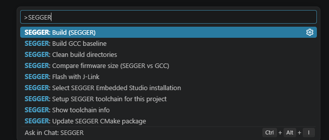
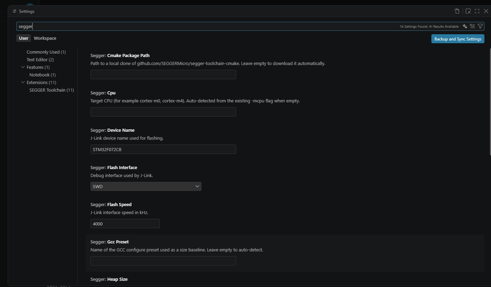

# SEGGER Toolchain для VS Code

Расширение, которое собирает проекты STM32 (и другие Cortex-M) **компилятором SEGGER из SEGGER Embedded Studio** через CMake + Ninja — без запуска самой IDE.

```
VS Code  →  CMake  →  Ninja  →  cc.exe -segger  (SEGGER Embedded Studio)
                                      ↓
                                 SEGGER linker + SEGGER RTL
```

## Зачем это

SEGGER-компилятор не поставляется отдельно — он лежит внутри Embedded Studio. Расширение даёт к нему доступ из CMake + Ninja в VS Code.

Насколько он реально меньше GCC — мы измерили на примере STM32F072 (методика и полная таблица ниже):

| Конфигурация | Flash |
|---|---|
| GCC `-O2` + newlib-nano (как в исходном проекте) | 1264 B |
| GCC `-Os -flto` + newlib-nano | 1192 B |
| **SEGGER `-Os` + SEGGER RTL** | **978 B** |
| GCC `-Os -flto` без libc | 940 B |

Против GCC «из коробки» SEGGER выигрывает ~22 %, но почти вся разница — это **newlib-nano**, а не кодогенерация. В прошивке, которая не использует libc, открытый GCC с `-Os -flto` даёт даже меньше байт.

**Декомпиляция не нужна.** С июля 2025 SEGGER официально поддерживает CMake: [SEGGERMicro/segger-toolchain-cmake](https://github.com/SEGGERMicro/segger-toolchain-cmake). Достаточно вызвать `bin/cc.exe -segger` и подключить их toolchain-файл. Расширение автоматизирует всё вокруг этого: поиск IDE, скачивание пакета, конвертацию GCC-проекта, пресеты, сборку, сравнение размеров и прошивку.

## Что умеет

- **Находит SEGGER Embedded Studio** в стандартных местах (`C:\Program Files\SEGGER`, `%LOCALAPPDATA%\SEGGER`, …), в `PATH` или по пути из настроек.
- **Скачивает официальный CMake-пакет** SEGGER с GitHub (закреплённый коммит) и кладёт его в проект — проект остаётся переносимым.
- **Конвертирует GCC-проект**: startup-файл, таблица прерываний, linker script, флаги линковщика, `CMakeUserPresets.json`.
- **Не ломает GCC-сборку**: изменения обёрнуты в `if(CMAKE_TOOLCHAIN_FILE MATCHES "segger-toolchain")`, исходные строки сохранены в ветке `else()`.
- **Собирает** через `cmake --preset` / `cmake --build --preset`.
- **Сравнивает размер прошивки** SEGGER и GCC в отдельной панели.
- **Помнит предыдущий размер** и показывает разницу к прошлой сборке.
- **Генерирует `launch.json`** для отладки через cortex-debug + J-Link.
- **Прошивает через J-Link** (`JLink.exe -CommanderScript`).
- Показывает размер прошивки в статус-баре.

## Требования

| Компонент | Версия | Примечание |
|---|---|---|
| SEGGER Embedded Studio | 8.24+ (рекомендуется) | Старые версии тоже работают, если есть `bin/cc.exe` и `gcc/arm-segger/bin` |
| CMake | 3.22+ | `cmake` в `PATH` |
| Ninja | любая | `ninja` в `PATH` |
| VS Code | 1.85+ | |
| J-Link Software | опционально | только для прошивки |

Расширение **не содержит** бинарников SEGGER и не обходит лицензию: компилятор берётся из вашей установки Embedded Studio.

> **Важно:** «Accept» в диалоге Non-Commercial License включает только IDE. Командной строке нужен ключ, установленный через `emLicense`. Бесплатный ключ SFL запрашивается на [segger.com/purchase/licensing/license-request](https://www.segger.com/purchase/licensing/license-request/), затем:
>
> ```powershell
> "<SES>\bin\emLicense.exe" install "<ключ>"
> ```
>
> Setup проверяет `emLicense list` и предупредит, если ключа нет. Без ключа можно собирать в режиме `embuild` (см. «Два режима сборки»).

## Установка

### Из готового `.vsix` (рекомендуется)

1. Скачайте `segger-toolchain-0.3.0.vsix` из [Releases](https://github.com/Elintirs/segger-toolchain-vscode/releases).
2. Установите:

```powershell
code --install-extension segger-toolchain-0.3.0.vsix
```

3. Перезапустите VS Code. В списке расширений появится **SEGGER Toolchain (SES) for CMake** (`elintirs.segger-toolchain`).

### Из исходников

```powershell
git clone https://github.com/Elintirs/segger-toolchain-vscode.git
cd segger-toolchain-vscode
npm ci
npm run compile
npx @vscode/vsce package
code --install-extension segger-toolchain-0.3.0.vsix
```

Для разработки: откройте папку в VS Code и нажмите `F5` — запустится Extension Development Host.

## Быстрый старт

1. Откройте папку проекта (`examples/STM32F072` — готовый пример).
2. `Ctrl+Shift+P` → **SEGGER: Setup SEGGER toolchain for this project**.
3. Выберите установку Embedded Studio, если их несколько.
4. `Ctrl+Shift+P` → **SEGGER: Build (SEGGER)**.
5. **SEGGER: Compare firmware size (SEGGER vs GCC)** — таблица с разницей.
6. **SEGGER: Flash with J-Link** — прошивка.

Все команды собраны в палитре под общим префиксом `SEGGER`:



После сборки размер прошивки показывается в статус-баре, а сравнение с GCC
открывается отдельной панелью.

### Отладка

1. `Ctrl+Shift+P` → **SEGGER: Generate J-Link debug configuration**.
2. Установите расширение [cortex-debug](https://marketplace.visualstudio.com/items?itemName=marus25.cortex-debug) (VS Code предложит это сам через `.vscode/extensions.json`).
3. `F5` → **SEGGER: J-Link**.

Команда создаёт `.vscode/launch.json` и берёт устройство из `segger.deviceName`
(при Setup оно определяется по имени linker script, например `STM32F072CBTX_FLASH.ld` → `STM32F072CB`).
Для отладки нужен `arm-none-eabi-gdb`: из PATH или `segger.gdbPath`.

## Два режима сборки

| Режим | Что вызывается | Нужен CLI-ключ |
|---|---|---|
| `cmake` (по умолчанию) | CMake + Ninja + `cc.exe` | да |
| `embuild` | генерируется `.emProject`, запускается `emBuild.exe` | **нет** (SFL) |

Переключение — настройка `segger.buildBackend` или команда **SEGGER: Build via emBuild (no CLI key)**.

В режиме `embuild` расширение собирает параметры проекта (исходники, include-пути, define, регионы из `.ld`, CPU), генерирует `<project>.emProject` и вызывает `emBuild`. Результат — `Output/Debug/Exe/<project>.elf`, размер и прошивка работают как обычно.

Ограничения режима: нет CMake-таргетов и их зависимостей, переносятся не все флаги, инкрементальность своя (SES). Для типового STM32-проекта этого достаточно.

## Что именно меняется в проекте

Команда Setup создаёт:

```
<project>/
├── cmake/segger/                 # официальный SEGGER CMake-пакет (скопирован)
├── cmake_modules/Platform/       # флаги -mcpu для SEGGERClang
├── segger/
│   ├── SEGGER_Startup.S          # startup + векторы прерываний устройства
│   └── SEGGER_Flash.icf          # linker script для SEGGER Linker
├── CMakeUserPresets.json         # пресет segger-debug
├── .vscode/settings.json         # CMake Tools: использовать пресеты
└── .segger/backup/               # резервная копия CMakeLists.txt
```

В `CMakeLists.txt` добавляются блоки с маркерами:

```cmake
# >>> SEGGER TOOLCHAIN (managed:header) >>>
if(CMAKE_TOOLCHAIN_FILE MATCHES "segger-toolchain")
    set(CMAKE_SYSTEM_PROCESSOR arm-cortex-m0)
    list(APPEND CMAKE_MODULE_PATH "${CMAKE_CURRENT_SOURCE_DIR}/cmake_modules")
endif()
# <<< SEGGER TOOLCHAIN (managed:header) <<<
```

и аналогично для `STARTUP_FILE`, `LINKER_SCRIPT`, `target_link_options`. Повторный запуск Setup не плодит дубликаты — блоки заменяются.

### Startup и прерывания

Generic startup от SEGGER содержит только ядровые исключения. Расширение берёт таблицу векторов из CMSIS `startup_<device>.s`, которую уже использует GCC-проект, и генерирует из неё `ISR_HANDLER ...` строки для всех внешних прерываний устройства (для STM32F072 — 32 IRQ, включая `RTC_IRQHandler`). Поэтому обработчики вроде `RTC_IRQHandler` в `main.c` продолжают работать.

### Память и линковка

Регионы FLASH/RAM читаются из существующего GNU `.ld` файла (`MEMORY { ... }`) и передаются SEGGER линковщику:

```
-Wl,--add-region:FLASH1=0x20000@0x08000000
-Wl,--add-region:RAM1=0x4000@0x20000000
```

Из шаблона `SEGGER_Flash.icf` при этом удаляется NXP-специфичный блок `place at 0x400`
(он нужен только для Kinetis, где флеш начинается с нуля).

Размеры стека/кучи настраиваются: `segger.stackSize`, `segger.heapSize`.

## Настройки



| Настройка | По умолчанию | Описание |
|---|---|---|
| `segger.studioPath` | авто | путь к установке SES |
| `segger.cmakePackagePath` | авто | локальная копия `segger-toolchain-cmake` (офлайн) |
| `segger.cpu` | авто из `-mcpu` | например `cortex-m0` |
| `segger.deviceName` | `STM32F072CB` | имя устройства для J-Link |
| `segger.presetName` | `segger-debug` | имя пресета |
| `segger.gccPreset` | авто | пресет GCC для сравнения |
| `segger.jlinkPath` | авто | путь к `JLink.exe` |
| `segger.gdbPath` | авто | `arm-none-eabi-gdb` для cortex-debug |
| `segger.buildBackend` | `cmake` | `cmake` (cc.exe, нужен ключ) или `embuild` (SFL) |
| `segger.optimization` | `balanced` | оптимизация для emBuild: `none`, `balanced`, `size` |
| `segger.extraCFlags` | — | доп. флаги C для CMake-пресета |
| `segger.extraLinkFlags` | — | доп. флаги линковщика для CMake-пресета |
| `segger.extraDefines` | `[]` | доп. define-ы |
| `segger.extraIncludes` | `[]` | доп. include-пути |
| `segger.stackSize` | `1024` | стек, байт |
| `segger.heapSize` | `0` | куча, байт |
| `segger.flashInterface` | `SWD` | SWD/JTAG |
| `segger.flashSpeed` | `4000` | кГц |

## Если что-то пошло не так

| Симптом | Причина и что делать |
|---|---|
| `No binutils found ... /gcc/` | В установке SES нет каталога `gcc/arm-*`. Проверьте `segger.studioPath`, он должен указывать на папку с `bin/cc.exe`. |
| `error: no active license found` | IDE лицензирована, а CLI — нет. Запросите бесплатный ключ SFL и установите: `<SES>\bin\emLicense.exe install "<ключ>"`. Проверка: `emLicense.exe list`. |
| `undefined symbol __stack_end__` | Другая версия SEGGER Linker. Добавьте в пресет `-DCMAKE_EXE_LINKER_FLAGS=-Wl,--defsym=__stack_end__=<адрес конца RAM>`. |
| В логе видно `--specs=nano.specs` | Сборка идёт по GCC-ветке: не запускался Setup или проект не был сконвертирован. |
| `--add-region` не распознан | Линковщик не SEGGER. Убедитесь, что в пресете указан `cmake/segger/segger-toolchain.cmake`, а не GCC toolchain. |
| `JLink.exe was not found` | Установите J-Link Software или задайте `segger.jlinkPath`. |
| `Configure preset "segger-debug" not found` | Запустите **SEGGER: Setup SEGGER toolchain for this project**. |

## Замеры размера

Один проект, один linker script, одинаковые `-ffunction-sections -fdata-sections -Wl,--gc-sections`, замер `arm-none-eabi-size -B` (Flash = `.text` + `.data`):

| Конфигурация | text | data | Flash |
|---|---|---|---|
| GCC 14.2 `-O2` + newlib-nano | 1256 | 8 | 1264 |
| GCC `-Os` + newlib-nano | 1252 | 8 | 1260 |
| GCC `-O2 -flto` + newlib-nano | 1192 | 8 | 1200 |
| GCC `-Os -flto` + newlib-nano | 1184 | 8 | 1192 |
| Clang 23 `-Oz` + newlib-nano | 1352 | 8 | 1360 |
| GCC `-Os -flto`, без libc | 940 | 0 | 940 |
| Clang 23 `-Oz`, без libc | 956 | 0 | 956 |
| **SEGGER (`segger-cc` 20.1.3, `-Os`) + SEGGER RTL** | **978** | **0** | **978** |

«Без libc» — `-nostdlib` + заглушка `__libc_init_array`: прошивка не вызывает ни одной функции libc, поэтому newlib в неё не нужен.

Выводы:

- SEGGER против GCC «из коробки»: 1264 − 978 = **286 B** (22 %).
- Из этих 286 B **252 B** исчезают, если убрать newlib: GCC `-Os -flto` без libc даёт 940 B, то есть меньше SEGGER.
- Значит, на этом проекте выигрыш SEGGER — не кодогенерация, а компактный рантайм и линковщик.
- На проектах с `printf`/`malloc` картина будет другой: там решают SEGGER RTL или picolibc.

Воспроизвести:

```powershell
python test/bench.py
python test/bench.py --clang D:\LLVM\bin\clang.exe   # если установлен LLVM
```

## Ограничения и честные предупреждения

- **Конвертер рассчитан на типовой шаблон** STM32CubeMX/ручной CMake-проект: `set(STARTUP_FILE ...)`, `set(LINKER_SCRIPT ...)`, `target_link_options(<target> PRIVATE ...)`. Если структура другая, Setup выдаст ошибку и **ничего не запишет** (сначала всё проверяется, потом пишется). Резервная копия `CMakeLists.txt` создаётся всегда.
- **SEGGER RTL, а не newlib.** Файл `syscalls.c` с `_write/_close/...` в этом примере не участвует в сборке (он только проверяется на существование), поэтому конфликта нет. В других проектах newlib-заглушки могут быть не нужны — их можно исключить из таргета.
- **Отладка** не входит в расширение: для неё используйте [cortex-debug](https://marketplace.visualstudio.com/items?itemName=marus25.cortex-debug) + J-Link, как описано в [KB SEGGER](https://kb.segger.com/How_to_use_the_SEGGER_Toolchain_with_CMake).
- **Первый запуск требует интернета** (скачивается пакет SEGGER с GitHub). Дальше — офлайн. Можно указать локальный клон в `segger.cmakePackagePath`.
- **Прокси.** Загрузка идёт через Node `https`, настройка `http.proxy` VS Code не применяется автоматически.
- **Лицензия SES.** Условия использования Embedded Studio определяет SEGGER; расширение лишь вызывает уже установленный компилятор.

## Как это проверялось

- `npm run compile` — сборка без ошибок.
- `npm test` — 18 самопроверок: активация расширения, парсинг `.ld`, определение `-mcpu`, извлечение 32 IRQ из CMSIS, генерация startup, чистка ICF, поиск фейковой установки SES, скачивание официального пакета, полная конвертация примера, сохранение GCC-ветки, валидность пресетов, «всё или ничего» при ошибке, идемпотентность, генерация `launch.json`.
- **GCC-сборка примера выполнена реально**: CMake 4.4 + Ninja + Arm GNU 14.2, результат `text 1256 + data 8 = 1264 B`, `firmware.hex` создан. После конвертации GCC-пресет собирается с тем же результатом.
- **Линковка SEGGER-тулчейном проверена реально**: сгенерированные `SEGGER_Startup.S` и `SEGGER_Flash.icf` собраны `segger-cc` и слинкованы `segger-ld` через `emBuild` (SFL покрывает IDE/emBuild). Результат — `text 978 B, data 0, bss 1027` (включая стек 1024), все 32 IRQ на месте.
- Пресет `segger-debug` конфигурируется CMake, компилятор определяется как `SEGGERClang`.
- Размер прошивки читается либо `size`, либо встроенным парсером ELF32; проверено на реальном ELF — совпало с `arm-none-eabi-size` до байта.
- Замеры размеров воспроизводятся скриптом `test/bench.py` (GCC, Clang, вариант без libc).
- **Режим `embuild` проверен на реальной SES**: сгенерированный `.emProject` собран `emBuild` из расширения, результат `text 978 B`, ELF создан.
- Отдельной автоматизации требует только CLI-сборка через `cc.exe`: SEGGER требует установленный ключ (`emLicense install`), которого нет на машине разработки.

## Структура репозитория

```
src/
  extension.ts      команды, статус-бар, панель сравнения
  ses.ts            поиск установки Embedded Studio
  toolchainPkg.ts   загрузка официального SEGGER CMake-пакета
  project.ts        конвертация GCC-проекта
  devices.ts        .ld, IRQ, startup, Platform-модули
  presets.ts        CMakeUserPresets.json
  build.ts          cmake/ninja
  size.ts           размер прошивки
  flash.ts          J-Link
test/selftest.js    самопроверки
examples/STM32F072  исходный GCC-проект
```
